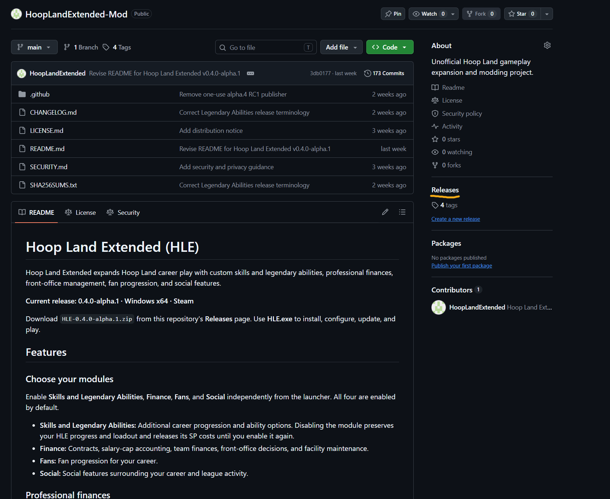
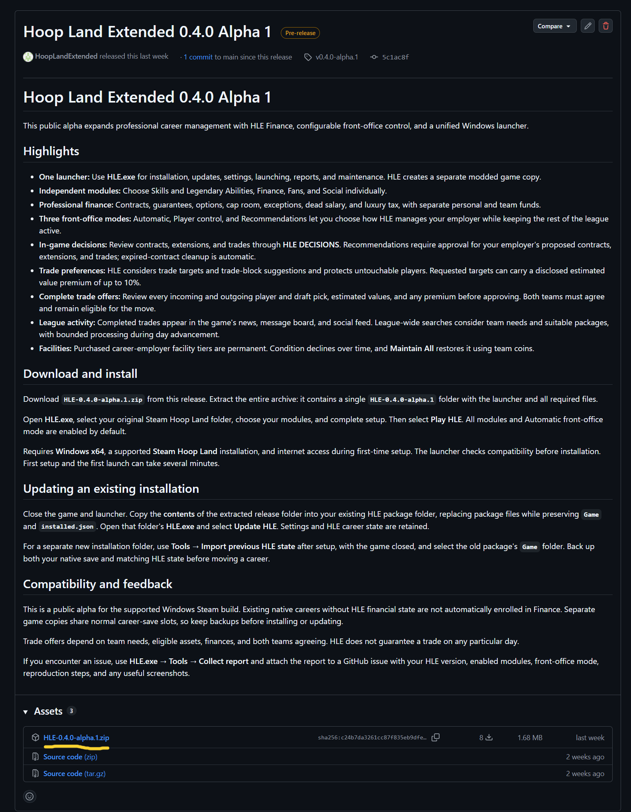
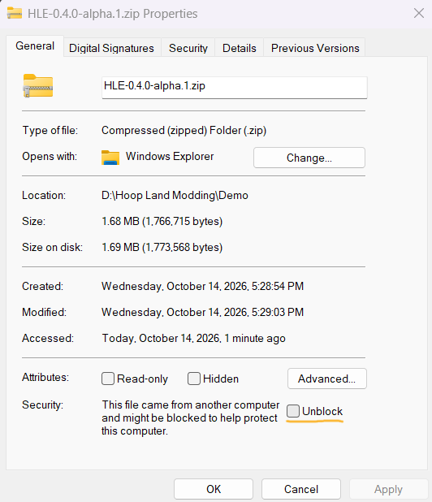
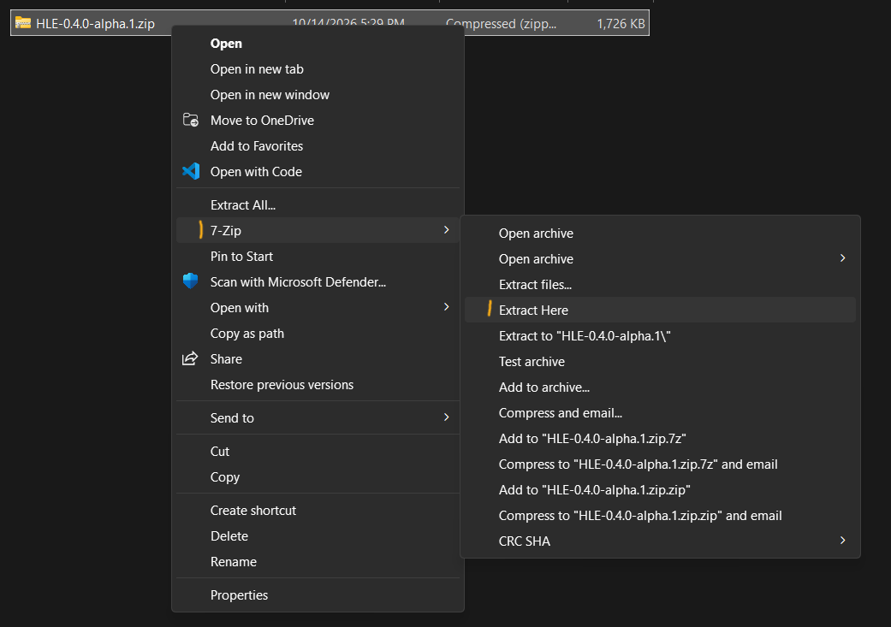
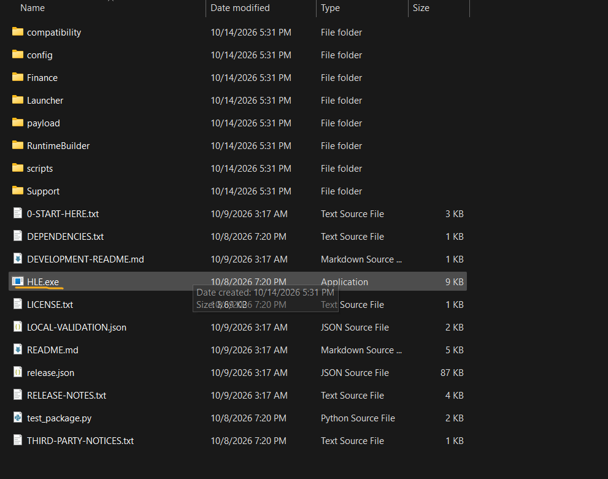
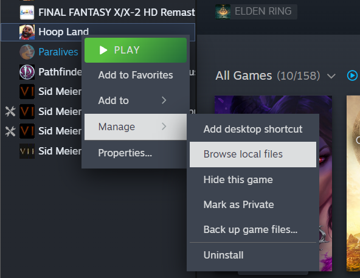
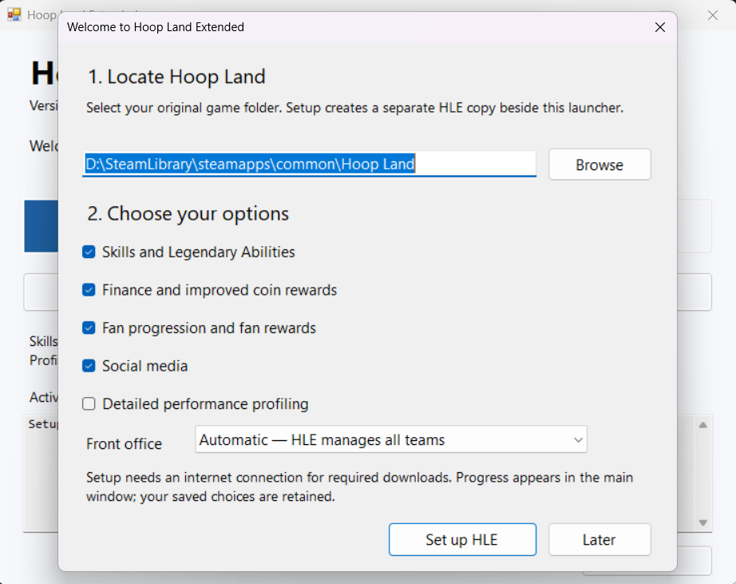
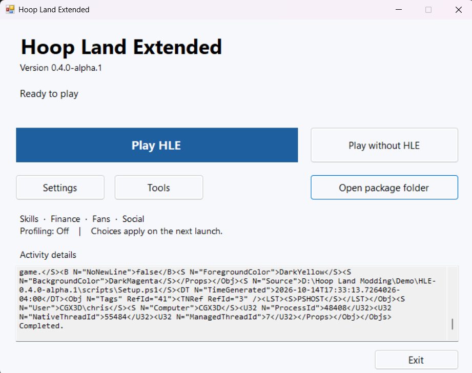

# Hoop Land Extended (HLE) - Illustrated Installation & Setup Guide

**Applies to:** Windows x64 / Steam. Illustrations are from public release `v0.4.0-alpha.1` (October 2026); check the [Releases page](https://github.com/HoopLandExtended/HoopLandExtended-Mod/releases) for newer builds and instructions.

> **Before you begin:** Install a supported version of Hoop Land through Steam. Initial HLE setup requires internet access. Back up your native careers and matching HLE state before updating, copying installations, or experimenting with save edits. HLE prepares a separate modded game copy, but normal career-save slots may still be shared.

## Step 1 - Download HLE

1. Open the [official HLE repository](https://github.com/HoopLandExtended/HoopLandExtended-Mod).
2. Click **Releases** on the right-hand side, or visit [HLE Releases](https://github.com/HoopLandExtended/HoopLandExtended-Mod/releases).
3. Open the appropriate release; under **Assets**, download the versioned HLE package (`HLE-0.4.0-alpha.1.zip` in the pictured version). **Do not download GitHub's automatic `Source code (zip)` archive.**

## Step 2 - Optional Windows unblock, then extract

1. Right-click the downloaded ZIP and open **Properties**.
2. If the **Unblock** checkbox appears on the General tab, select it and click **Apply**. Unblock only a file you obtained from the official release and trust. The checkbox is not present on all systems.
3. Extract the **entire ZIP** with Windows **Extract All...** or 7-Zip **Extract Here**.
4. Keep the extracted release folder together in a convenient location **outside your Steam Hoop Land installation folder**. It does not need to be on the same drive as the game.

## Step 3 - Open HLE.exe and set up

1. Inside the extracted release folder, run **HLE.exe** (it may display as just `HLE` when Windows hides file extensions).
2. On first setup, specify the **original Hoop Land Steam game folder**. To find it, open Steam > Library, right-click **Hoop Land**, then choose **Manage > Browse local files**. Copy or browse to that folder in HLE.
3. Choose the HLE modules to enable and the front-office control mode. Settings can be changed in the launcher later.
4. Click **Set up HLE**. The launcher prepares a separate modded game copy; first-time downloads require internet access and can take some time. Watch the progress in the launcher.

## Step 4 - Launch HLE

1. Once setup finishes, click **Play HLE** in the launcher.
2. On initial launch, be patient while components load. A save may take a few seconds longer to load than normal.
3. In-game, check for features from the modules you enabled, such as HLE Skills, Legendary Abilities, or career front-office options.
4. Use **Settings** in HLE.exe to change modules and **Tools** for maintenance and diagnostic reports. **Play without HLE** runs without the mod enabled.

## Updating an existing HLE package

1. **Close Hoop Land and HLE.exe.**
2. Back up your native save and the matching HLE state.
3. Download/extract the new release. Copy the **contents** of the new release folder into the existing HLE package folder, replacing package files **while preserving `Game` and `installed.json`**.
4. Open the updated **HLE.exe** and use **Update HLE** when prompted. Settings and HLE state should be retained.
5. For a **new, separate installation folder**, first set up HLE, then use **Tools > Import previous HLE state** with the game closed, selecting the prior package's `Game` folder.

**Important:** Installing HLE in a separate folder does not necessarily isolate native career saves; back up before overwriting an installation or experimenting with a different version.

## Troubleshooting and feedback

- **HLE cannot find Hoop Land:** Choose the original Steam game directory, not a ZIP, HLE folder, or save directory. Use Steam > Manage > Browse local files.
- **Setup fails:** Open **HLE.exe > Tools** and read launcher logs for the specific error. Check required first-time internet access and the supported game build.
- **Mod features do not appear:** Ensure you launched via **Play HLE**, the module is enabled, and the update/setup finished. Restart after changing options.
- **Moving an installation:** Preserve the old `Game` and state until the new package is verified, and use the state-import tool rather than manually mixing unrelated files.
- **Report an issue:** Go to **HLE.exe > Tools > Collect Report** and attach the report to a [GitHub issue](https://github.com/HoopLandExtended/HoopLandExtended-Mod/issues). Include HLE version, enabled modules, front-office setting, reproduction steps, screenshots if helpful, and any errors.

*Screenshots supplied by the HLE maintainer; UI may vary by release.*

<!-- PDF v1.1 prioritizes complete screenshots with labeled zoom insets and a landscape layout. -->
